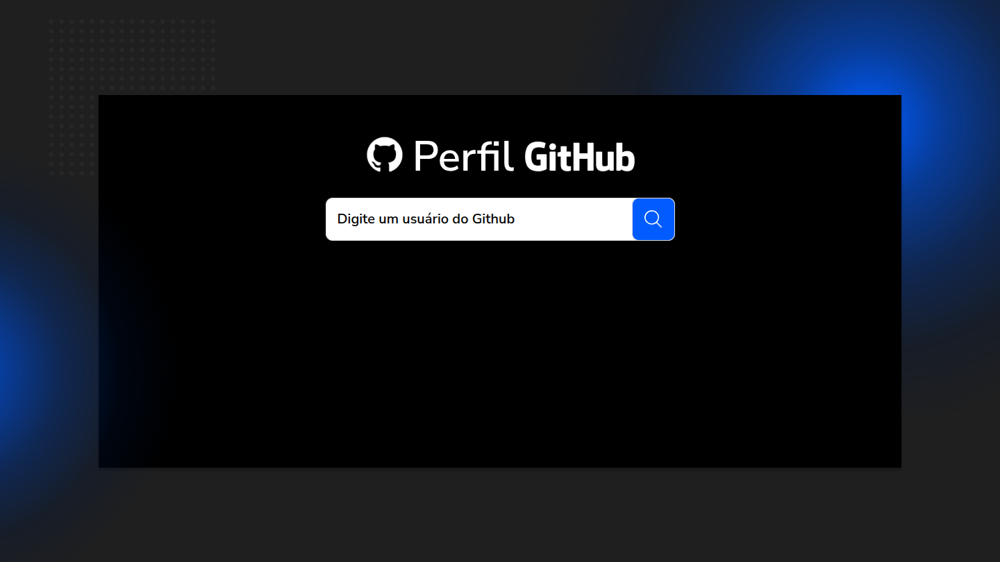
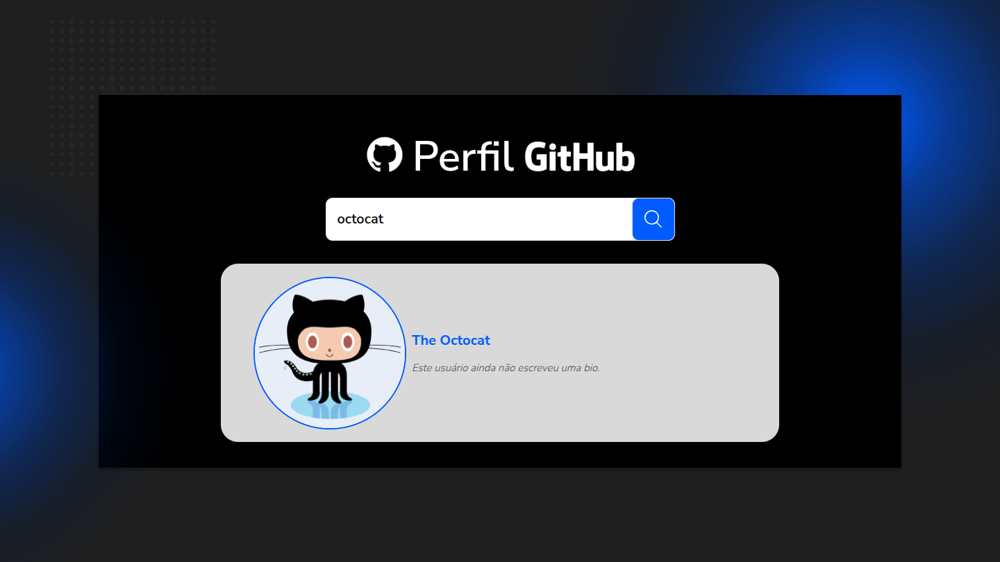
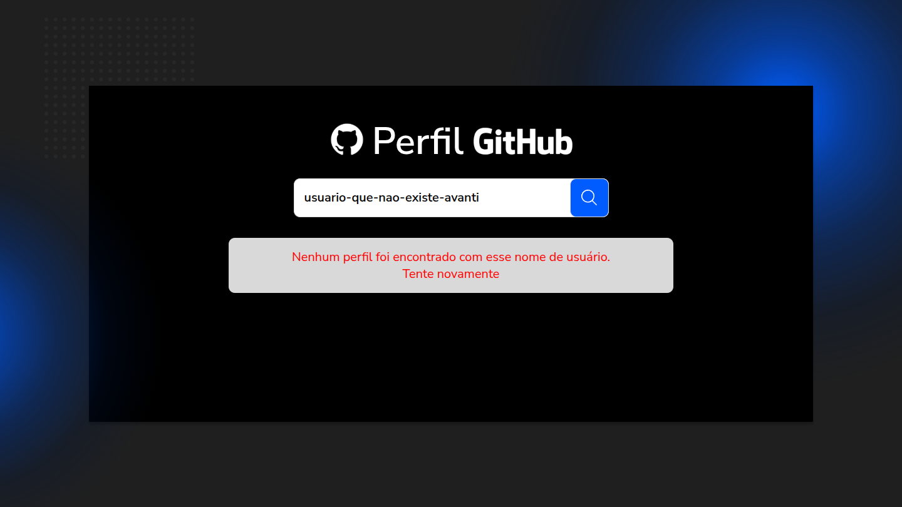
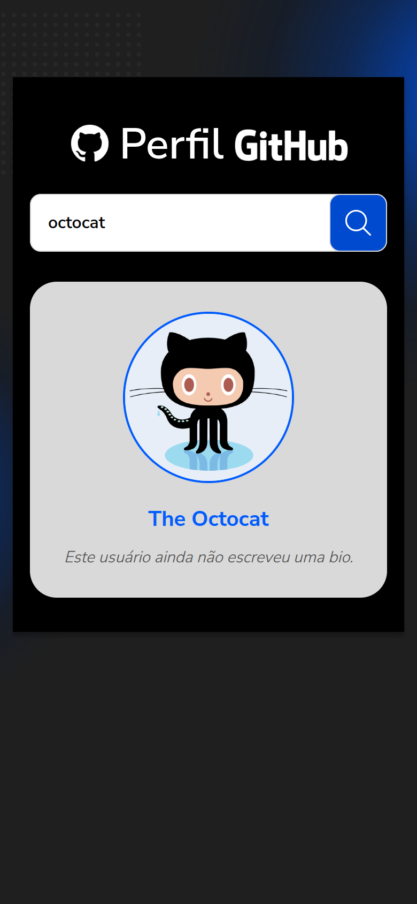

# Desafio 02 – Busca de Perfil no GitHub

Projeto desenvolvido para o **Avanti Innovation Challenge – Innovation Class 19**.

Aplicação em React que busca perfis do GitHub pela API pública e exibe nome, foto e bio do usuário, seguindo o layout do Figma.

🔗 **Acesse o projeto:** https://lelokz.github.io/Desafio-02-Github/

| Tela inicial | Perfil encontrado |
|---|---|
|  |  |

| Perfil não encontrado | Mobile |
|---|---|
|  |  |

## Requisitos

- [x] Campo de busca para informar o nome de um perfil do GitHub
- [x] Ao clicar no botão de busca, a aplicação consome a API do GitHub
- [x] Exibe nome, foto de perfil e bio do usuário
- [x] Exibe mensagem de erro caso o perfil não seja encontrado
- [x] Estilização seguindo o design do Figma
- [x] Opcional: efeitos visuais e loading durante a requisição

## Funcionalidades

- Busca pelo botão da lupa ou pela tecla Enter; campo vazio não dispara requisição.
- Indicador de carregamento durante a requisição e animação de entrada do resultado.
- Mensagens específicas para cada situação:
  - perfil não encontrado (texto do Figma);
  - limite de requisições da API atingido (60 por hora sem autenticação);
  - falha de conexão;
  - erro inesperado da API.
- Perfil sem nome cadastrado exibe o nome de usuário; perfil sem bio exibe um aviso.
- O nome do perfil leva à página do usuário no GitHub.
- Uma nova busca cancela a anterior, evitando que uma resposta antiga substitua a mais recente.
- Layout adaptado para tablet e celular.
- Acessibilidade: campo com rótulo, resultado anunciado por leitores de tela, navegação por teclado e respeito à preferência por menos movimento.

## Tecnologias

- [React 19](https://react.dev/)
- [Vite 8](https://vite.dev/)
- CSS puro, organizado por componente
- [API REST do GitHub](https://docs.github.com/pt/rest/users/users#get-a-user)
- [oxlint](https://oxc.rs/docs/guide/usage/linter) para análise do código
- GitHub Actions para publicar no GitHub Pages a cada push

## Estrutura

```
src/
├── components/
│   ├── Header.jsx          # logo "Perfil GitHub"
│   ├── SearchForm.jsx      # campo e botão de busca
│   ├── ProfileCard.jsx     # foto, nome e bio
│   ├── ErrorMessage.jsx    # caixa de erro
│   └── Loader.jsx          # indicador de carregamento
├── hooks/
│   └── useGithubProfile.js # estados da busca (inicial, carregando, encontrado, erro)
├── services/
│   └── github.js           # requisição à API e tratamento das respostas
├── assets/                 # imagens exportadas do Figma
├── App.jsx
└── main.jsx
```

## Como executar

Requer [Node.js](https://nodejs.org/) 20.19 ou superior.

```bash
npm install
npm run dev
```

Outros comandos:

```bash
npm run build    # gera a versão de produção em dist/
npm run preview  # serve a versão de produção localmente
npm run lint     # analisa o código
```

## Decisões de implementação

- **Fidelidade ao Figma:** medidas, cores, fontes, sombras e gradientes foram extraídos do arquivo do Figma. As luzes azuis do fundo reproduzem a mistura de cores do gradiente do Figma.
- **Separação de responsabilidades:** o serviço só conversa com a API, o hook controla o estado da busca e os componentes apenas exibem os dados.
- **Sem dependências extras:** a requisição usa `fetch` e o cancelamento usa `AbortController`, ambos nativos do navegador.
- **Versão mobile:** o Figma define apenas a versão desktop (1440px); a adaptação para telas menores mantém a mesma identidade visual.
